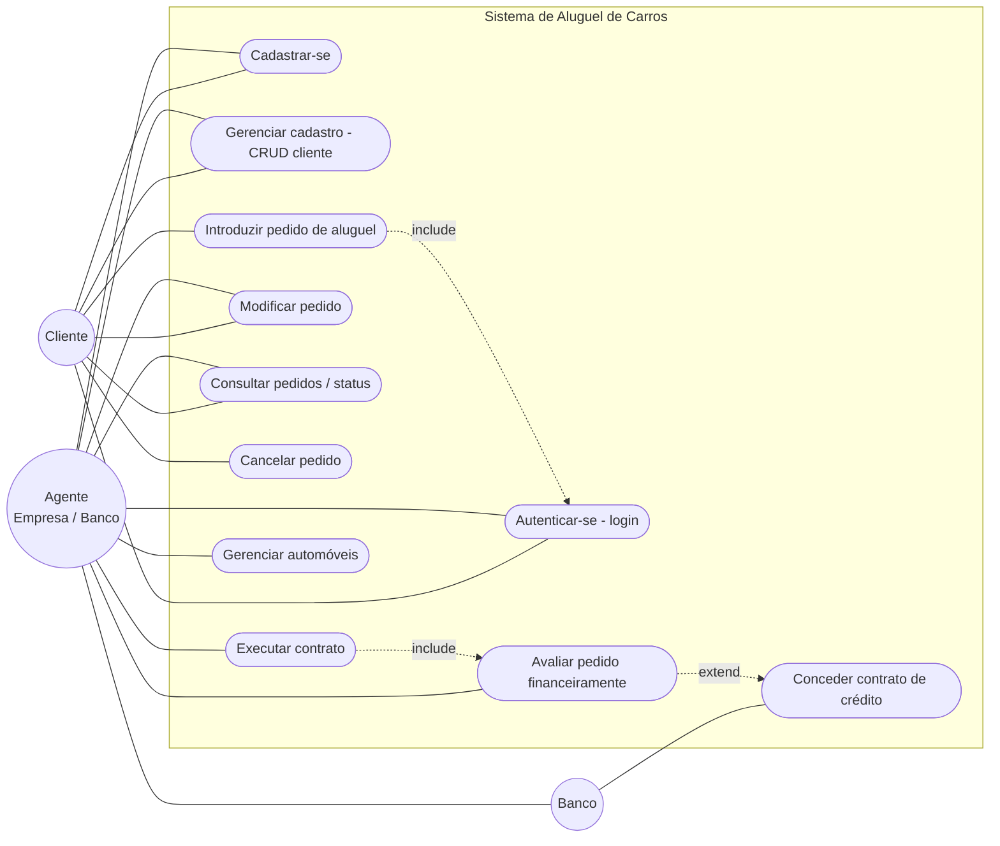
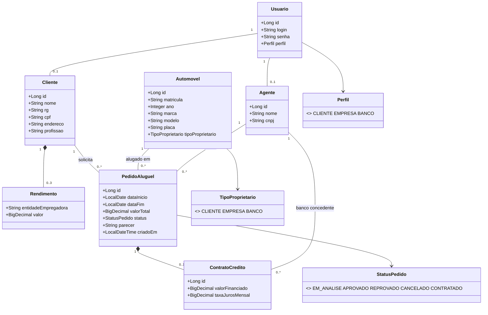
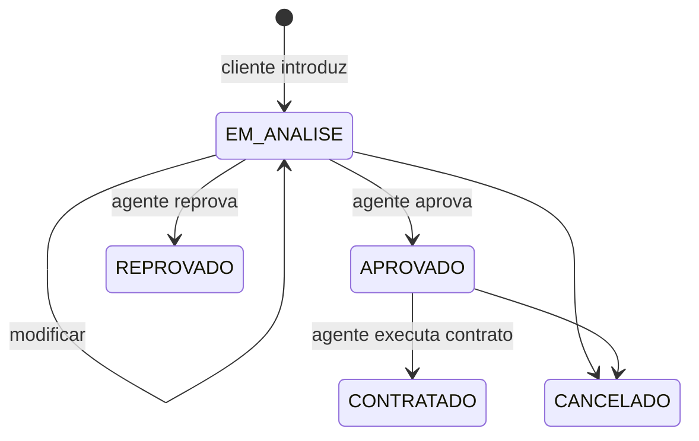
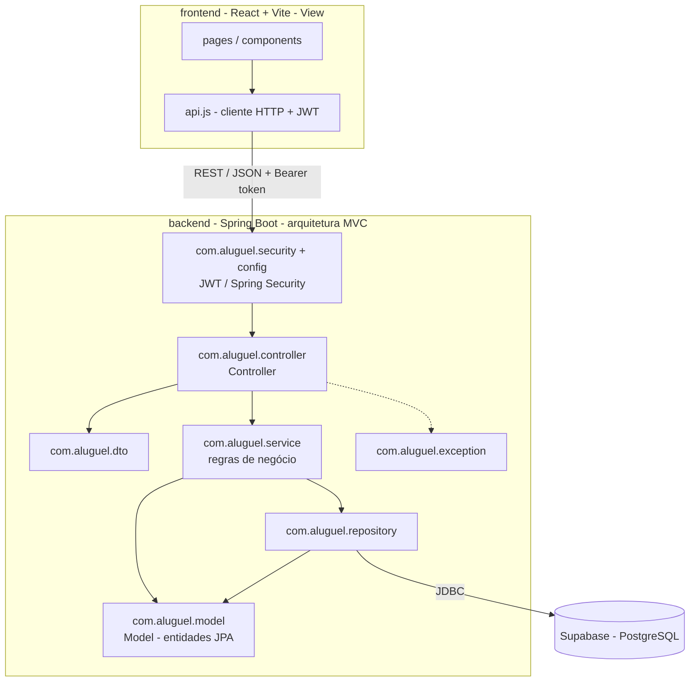

# Modelagem do Sistema de Aluguel de Carros

Diagramas em Mermaid (renderizados automaticamente pelo GitHub). Versão **1.1** — ver histórico no final.

## 1. Diagrama de Casos de Uso

## 2. Histórias de Usuário

| ID | Como... | Quero... | Para... | Critérios de aceite |
|----|---------|----------|---------|---------------------|
| US01 | visitante | me cadastrar com usuário e senha, informando RG, CPF, nome, endereço, profissão e até 3 rendimentos | poder usar o sistema | CPF/RG/login únicos; senha ≥ 6 caracteres; máximo de 3 rendimentos |
| US02 | usuário cadastrado | fazer login com usuário e senha | acessar as funções do meu perfil | sem login, a API responde 401; senha inválida é rejeitada |
| US03 | cliente | consultar, alterar e excluir meu cadastro | manter meus dados atualizados | só acesso ao próprio cadastro; exclusão bloqueada se houver pedidos |
| US04 | cliente | introduzir um pedido de aluguel de um automóvel | alugar o veículo | período válido, sem conflito com outro pedido ativo; nasce `EM_ANALISE` |
| US05 | cliente | consultar o status dos meus pedidos | acompanhar a análise | lista somente meus pedidos |
| US06 | cliente ou agente | modificar um pedido | corrigir datas, veículo ou valor | somente em `EM_ANALISE` |
| US07 | cliente ou agente | cancelar um pedido | desistir do aluguel | somente em `EM_ANALISE` ou `APROVADO` |
| US08 | agente | avaliar financeiramente um pedido | aprovar ou reprovar | registra avaliador e parecer; só em `EM_ANALISE` |
| US09 | banco | conceder contrato de crédito ao aprovar | financiar o aluguel | apenas perfil `BANCO`; informa valor financiado e juros |
| US10 | agente | executar o contrato de um pedido aprovado | formalizar o aluguel | só em `APROVADO`; passa a `CONTRATADO` |
| US11 | agente | cadastrar e manter automóveis (matrícula, ano, marca, modelo, placa, proprietário) | disponibilizar frota | placa e matrícula únicas; proprietário = cliente, empresa ou banco |

## 3. Diagrama de Classes

### Estados do pedido

## 4. Diagrama de Pacotes (Visão Lógica) e Arquitetura MVC

Os dois subsistemas do enunciado: **gestão de pedidos e contratos** (pacotes `service`/`controller`/`model` do back-end) e **construção dinâmica das páginas web** (front-end React, que monta as telas a partir dos dados da API).

## 5. Histórico de versões dos modelos

| Versão | Mudança |
|--------|---------|
| 1.0 | Modelo inicial: Usuario, Cliente, Automovel, PedidoAluguel, casos de uso básicos. |
| 1.1 | Inclusão de `Agente` (empresa/banco), `Rendimento` (máx. 3), `ContratoCredito`, estados do pedido e `TipoProprietario`; autenticação JWT no pacote `security`. |
